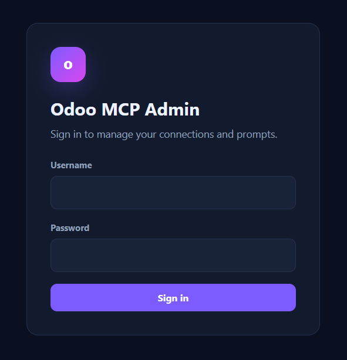
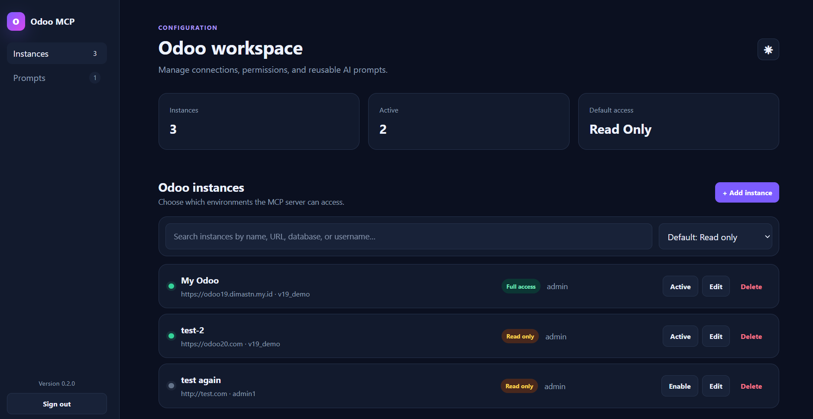
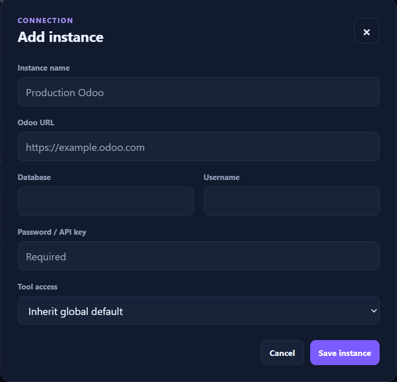
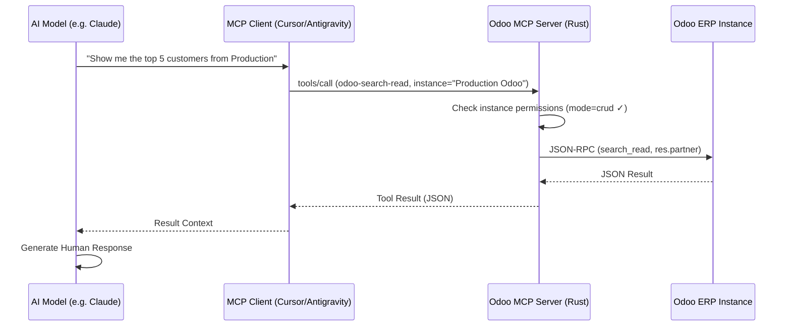
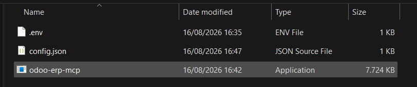

# Odoo ERP MCP Server (Rust)

A high-performance, secure Model Context Protocol (MCP) server built in Rust for seamless interaction with Odoo ERP systems. This server allows AI models (like Claude, GPT-4, etc.) to perform advanced ORM operations and data analysis on Odoo models natively.

[](https://github.com/dimastriann/odoo-erp-mcp/releases)
[](LICENSE)
[](#-download)

## 🚀 Features

- **Standard CRUD**: Search, Create, Update, and Delete any Odoo model.
- **Advanced Tools**:
    - `odoo-search-read`: Search and retrieve records with field selection.
    - `odoo-search`: Search and return only record IDs.
    - `odoo-read`: Read specific records by ID.
    - `odoo-search-count`: Get record counts matching specific criteria.
    - `odoo-read-group`: Perform aggregated analysis (group by, sums, counts).
    - `odoo-copy`: Quickly duplicate existing records.
    - `odoo-get-metadata`: Inspect model structures and field definitions.
    - `odoo-list-models`, `odoo-check-access`, `odoo-onchange`, `odoo-name-search`, `odoo-get-views`: Discover models, access, UI semantics, and relation labels.
    - `odoo-list-reports`, `odoo-render-report`: Discover and render HTML or base64 PDF reports.
    - `odoo-create-batch`, `odoo-update-batch`, `odoo-delete-batch`: Batch mutations with per-item results and approval gating.
    - `odoo-preview`: Preview create, update, or delete operations without writing.
    - `odoo-get-model-schema`, `odoo-get-relations`, `odoo-get-enum-values`, `odoo-get-required-fields`, `odoo-find-relation-path`, `odoo-explain-relation`: Discover and explain Odoo semantics and relationships.
    - `odoo-list-workflows`, `odoo-workflow`: Run curated, approval-gated business actions such as sales-order confirmation, invoice posting, stock validation, cancellation, and sale-order chatter messages.
    - `odoo-aggregate`, `odoo-list-business-reports`, `odoo-business-report`: Run protected aggregations and curated sales, inventory, CRM, accounting, and purchasing reports. Reports accept `company_id`, resolve its currency, and return the effective date range and timezone.
- **Multi-Instance Support**: Configure and keep **multiple Odoo instances active simultaneously**. Each tool call can target a specific instance by ID or name, or fall back to the default active one.
- **Folders and Live Configuration**: Organize instances into folders, enable or disable tools globally and per instance, and receive MCP `tools/list_changed` notifications without restarting the server.
- **Odoo 19/20 Ready**: Per-instance `rpc_transport` supports JSON-RPC fallback or JSON-2 bearer API keys with automatic version detection.
- **Global & Per-Instance Tool Permissions**:
    - Set a **Global Default Mode** (`crud` or `read_only`) that applies to all instances by default.
    - **Override per instance**: each instance can be set to `crud`, `read_only`, or `inherit` (from global).
    - Or use a **custom `allowed_tools` list** for fine-grained control.
- **Web Configuration UI**: Modern dark/light mode interface at `http://localhost:3333` to manage instances, permissions, and AI prompts — no config file editing needed.
- **Protocol Version 2025-11-25**: Built on the latest stable MCP specification.

## 📸 Screenshots

### Secure Admin Login

The configuration dashboard is protected by the administrator credentials supplied through `ODOO_MCP_UI_USERNAME` and `ODOO_MCP_UI_PASSWORD`.



### Configuration Dashboard

The responsive workspace summarizes total and active instances, shows the server version, supports instance search, and provides global and per-instance access controls. Connection secrets are never returned to the browser after they are saved.



### Add or Edit an Odoo Instance

Configure the instance URL, database, Odoo username, credential source, and authorization policy. Environment-backed credentials are recommended; the UI stores only their variable names. Legacy modes remain available, while capability policy controls cover instance-level allow/deny rules and an advanced scoped editor covers models, operations, fields, and methods. The UI warns about default-deny behavior and validates malformed, conflicting, or accidentally empty policies before saving.



## 🛠 Tech Stack

- **Rust**: Language of choice for performance and safety.
- **Tokio**: Asynchronous runtime for non-blocking I/O.
- **Axum**: Lightweight web framework for the configuration UI.
- **Reqwest**: For handling Odoo JSON-RPC communication.
- **Serde**: For high-speed JSON serialization.

## 🧭 Source Layout

The Rust source is organized by responsibility:

```text
src/
├── mcp/       # MCP transport, request handling, and dispatch
├── odoo/      # Odoo JSON-RPC client and per-instance client manager
├── tools/     # Tool schemas, arguments, execution, and results
├── views/     # Web configuration UI and static assets
├── config.rs  # Persistent server and instance configuration
├── domain.rs  # Shared domain validation
├── error.rs   # Typed application errors and wire error codes
├── policy.rs  # Capability policy evaluation and precedence
├── secret.rs  # Redacted secrets and credential providers
└── main.rs    # Process bootstrap and module composition
```

## 📦 Getting Started

### Prerequisites

- [Rust & Cargo](https://rustup.rs/) 1.88 or newer
- An Odoo Instance (v12 to v19+ supported)

### Local Development

1. **Clone the repository**:
   ```bash
   git clone <repo-url>
   cd odoo-erp-mcp
   ```

2. **Copy the example config**:
   ```bash
   cp config.example.json config.json
   ```

3. **Run the server**:
   ```bash
   # Set persistent Web UI administrator credentials first
   export ODOO_MCP_UI_USERNAME=admin
   export ODOO_MCP_UI_PASSWORD='replace-with-a-strong-password'
   cargo run
   ```

   PowerShell equivalent:
   ```powershell
   $env:ODOO_MCP_UI_USERNAME = "admin"
   $env:ODOO_MCP_UI_PASSWORD = "replace-with-a-strong-password"
   cargo run
   ```

4. **Configure via UI**:
   Open `http://localhost:3333`, sign in, and add your Odoo instance credentials. Changes are saved automatically to `config.json`. If `ODOO_MCP_UI_PASSWORD` is omitted, the server generates a temporary password and prints it to stderr at startup.

The Web UI listens on `127.0.0.1:3333` by default. Set `ODOO_MCP_UI_BIND` (for example, `0.0.0.0:3333`) only when remote access is intentional, and place it behind HTTPS because its session cookie is designed for the local HTTP default.

#### Remote MCP transport

Remote MCP is disabled by default. Enable it explicitly with
`global_settings.remote_mcp`:

```json
"remote_mcp": {
  "enabled": false,
  "bind_address": "127.0.0.1:3334",
  "api_key_envs": ["ODOO_MCP_REMOTE_API_KEY_CURRENT"],
  "rate_limit_per_minute": 120,
  "max_request_bytes": 1048576,
  "max_sessions": 256,
  "session_ttl_secs": 3600
}
```

When enabled, the server exposes `POST /mcp` as a JSON-RPC-over-HTTP endpoint
and reuses the same transport-independent MCP core as stdio. Requests must use
`Authorization: Bearer <credential>`. API keys are read from `api_key_envs`
(or the older scalar `api_key_env`) and only SHA-256 hashes are kept in memory.
Supplying both the current and previous key enables zero-downtime rotation;
remove the old key after clients have switched. Each key is limited to
`rate_limit_per_minute` requests (default `120`); excess requests receive
`429 Too Many Requests` with `Retry-After`. Request bodies are capped at
`max_request_bytes` (default `1048576`). Initialize creates an
`Mcp-Session-Id`; send it on later requests. Sessions are bound to the
authenticated credential, expire after `session_ttl_secs` (default `3600`), and
are capped by `max_sessions` (default `256`). Send `DELETE /mcp` with the
session header to terminate one explicitly. Notifications return
`202 Accepted`. Non-loopback binds reject requests unless the reverse proxy sets
`x-forwarded-proto: https`; configure that proxy to strip or override this
header from client input. Keep `remote_mcp.enabled` set to `false` unless HTTPS
and a supported credential source is configured.

HS256 JWTs can replace or supplement API keys:

```json
"jwt_hs256_secret_env": "ODOO_MCP_REMOTE_JWT_SECRET"
```

JWTs must use `alg: HS256`, include a non-empty `sub`, include `exp`, and pass
the optional `nbf` check. Use a high-entropy secret of at least 32 bytes. JWT
principals are derived from the issuer and subject, so sessions are bound to
that identity.

OAuth 2.1 resource-server validation can replace or supplement local JWT
validation:

```json
"oauth": {
  "issuer": "https://issuer.example.com",
  "audience": "odoo-mcp",
  "jwks_url": "https://issuer.example.com/.well-known/jwks.json"
}
```

Only asymmetric RS256/384/512 and ES256/384 tokens are accepted. The JWKS is
fetched at startup; if it is unavailable, the remote transport fails closed.
The issuer, audience, expiry, not-before, and key id are validated.

RBAC can restrict remote tool calls by authenticated principal:

```json
"rbac": {
  "default_role": "viewer",
  "roles": {
    "viewer": { "allow": ["read"] },
    "editor": { "allow": ["read", "update"], "deny": ["delete"] }
  },
  "principals": {
    "https://issuer.example.com:user-42": ["editor"]
  },
  "api_key_subjects": {
    "ODOO_MCP_REMOTE_API_KEY": "service:automation"
  }
}
```

JWT/OAuth principals use `issuer:subject`. API keys can be mapped to a subject
through `api_key_subjects`. Deny wins over allow; unmatched principals use
`default_role`, and no matching role means denied.

Tenant and instance scoping is enforced for remote callers:

```json
"tenants": [
  {
    "id": "tenant-a",
    "name": "Tenant A",
    "secret_envs": ["TENANT_A_ODOO_PASSWORD"]
  }
],
"rbac": {
  "principal_tenants": {
    "https://issuer.example.com:user-42": "tenant-a"
  },
  "principal_instances": {
    "https://issuer.example.com:user-42": ["1"]
  }
}
```

Instances in a multi-tenant configuration must declare `tenant_id`. When a
tenant defines `secret_envs`, its instances must use one of those
`password_env` names. When `principal_tenants` or `principal_instances` is set,
remote callers without a matching subject are denied; `odoo-list-instances`
returns only the instances they may access. Audit and approval records carry
the tenant identity for isolation and review.

#### Kubernetes
Kubernetes manifests are in `deploy/k8s`. They include a namespace, PVC,
ConfigMap, Deployment, Service, and an nginx Ingress for `/mcp`.

1. Copy/edit `deploy/k8s/configmap.yaml` with your tenants and instances.
2. Create the secret from `deploy/k8s/secret.example.yaml`.
3. Apply the manifests:
   ```bash
   kubectl apply -f deploy/k8s/namespace.yaml
   kubectl apply -f deploy/k8s/secret.example.yaml
   kubectl apply -k deploy/k8s
   ```
4. Replace the placeholder image and host/TLS secret before production use.

Back up the PVC (`/data`) and the `odoo-erp-mcp-config` ConfigMap before
upgrades. The PVC contains audit and approval state; the ConfigMap holds
`config.json`. To recover, restore both and re-apply the manifests; rotate the
API/JWT secrets and update the Kubernetes Secret after any suspected exposure.

### Configuration

The server stores its configuration in `config.json` (excluded from git). Use `config.example.json` as a starting template.

```json
{
  "global_settings": {
    "default_mode": "crud",
    "rpc_connection_timeout_secs": 10,
    "rpc_request_timeout_secs": 30,
    "rpc_max_response_bytes": 10485760,
    "max_query_limit": 1000,
    "max_requested_fields": 100,
    "max_read_ids": 100,
    "max_domain_depth": 8,
    "max_domain_terms": 100,
    "max_response_records": 1000,
    "max_domain_in_values": 1000
  },
  "instances": [
    {
      "id": "1",
      "name": "Production Odoo",
      "url": "https://your-odoo-instance.example.com",
      "db": "your_database",
      "username": "admin",
      "password_env": "ODOO_PASSWORD",
      "active": true,
      "mode": "crud",
      "allowed_tools": null,
      "permissions": {
        "allow": ["read", "create", "update", "delete"],
        "models": {
          "account.move": {
            "deny": ["delete"],
            "fields": {
              "deny": ["payment_state"]
            },
            "methods": {
              "action_cancel": "deny"
            }
          }
        }
      },
      "query_limits": {
        "max_query_limit": 250,
        "max_response_records": 250
      }
    },
    {
      "id": "2",
      "name": "Staging Odoo",
      "url": "https://staging.example.com",
      "db": "staging_db",
      "username": "admin",
      "password_env": "ODOO_STAGING_PASSWORD",
      "active": true,
      "mode": "read_only",
      "allowed_tools": null
    }
  ],
  "prompts": []
}
```

Set each referenced variable in the process environment or in the `.env` file
next to `config.json`:

```dotenv
ODOO_PASSWORD=your_production_password_or_api_key
ODOO_STAGING_PASSWORD=your_staging_password_or_api_key
```

`password_env` names an environment variable; it never contains the credential
itself. Startup fails if a referenced variable is missing. Resolved secrets are
redacted from debug and normal serialized output and are not written back into
`config.json`. Restrict `.env` and `config.json` to the account running the MCP
server. On Unix, use mode `0600`; on Windows, restrict their ACLs to the service
account and administrators.

#### Migrating inline credentials

The legacy `"password": "..."` field remains supported temporarily and emits a
migration warning at startup. Migrate one instance at a time:

1. Move the current password or API key into an environment variable or `.env`.
2. Replace `password` in that instance with `"password_env": "VARIABLE_NAME"`.
3. Restart the server and verify that the instance connects.
4. Remove the plaintext value from configuration backups and deployment logs.

When both fields are present, `password_env` takes precedence. Never commit
`.env` or a populated `config.json` to version control.

#### RPC transport and Odoo 19/20 API keys

Odoo 19 deprecates the XML-RPC and JSON-RPC endpoints in favour of the external
JSON-2 API, and Odoo 20 removes the `db` service. The gateway keeps JSON-RPC as
a compatibility fallback and can use JSON-2 per instance:

```json
{
  "rpc_transport": "auto"
}
```

| Value | Behaviour |
|-------|-----------|
| `auto` | Detect the Odoo version; use JSON-2 for Odoo 19+ and fall back to JSON-RPC if JSON-2 rejects the credential |
| `jsonrpc` | Use `/jsonrpc` and `execute_kw` |
| `json2` | Use `POST /json/2/<model>/<method>` with a bearer API key |

JSON-2 requires an Odoo API key with the `rpc` scope. Store the API key in
`password_env` exactly like a password; the server sends it as an
`Authorization: Bearer` header and never logs or serializes it. A plain password
may continue to use JSON-RPC. JSON-RPC and XML-RPC remain functional through
Odoo 20 but are scheduled for removal in Odoo 22.

#### Approval expiration

High-risk mutations return an `approval_required` result instead of executing.
The approval inbox in the admin UI can approve or reject the request. Approvals
are single-use, bound to the payload, actor, instance, model, and operation
kind, and expire after `global_settings.approval_ttl_secs` (default `900`
seconds). Approval state is stored in `approvals.json` next to `config.json`;
the file is excluded from version control.

#### Batch mutation semantics

`odoo-create-batch` is all-or-nothing per Odoo create call and verifies every
returned ID. `odoo-update-batch` and `odoo-delete-batch` execute one item at a
time and return per-item success or failure, so partial results are possible.
The whole batch passes risk and approval checks before any item executes. An
optional idempotency key is scoped per item. Batch size is limited by
`global_settings.max_batch_size` (default `100`).

#### Live configuration and folders

The MCP server emits 
otifications/tools/list_changed` after configuration
changes and exposes `_meta.configRevision` on tool listings and calls.
`odoo-list-instances` returns the current active state, folders, and tool
availability without contacting Odoo. Cached Odoo clients are invalidated when
an instance is edited, deleted, or toggled active. These updates apply to
changes made through the admin UI; direct `config.json` edits still require a
server restart.

Folders are single-level. Each instance may reference one `folder_id`, and the
`folders` array is stored in `config.json`. Deleting a folder keeps its instances
and clears their `folder_id` (they become ungrouped). Existing configurations
without `folders` or `folder_id` load unchanged.

#### Audit and observability

Audit events are written to `audit.log.jsonl` next to `config.json`. Each event
is versioned, hash-chained to the previous event, redacts sensitive keys, and
records policy decisions, disabled-tool rejections, approvals, execution
attempts, and outcomes. `global_settings.audit_retention_events` controls how
many events are retained (default `10000`). Authorized administrators can query
the newest events with `GET /api/audit?limit=100` and export the full trail with
`GET /api/audit/export`.

Runtime observability is available through:

- `GET /health` — process health and version.
- `GET /ready` — readiness based on configured instances.
- `GET /api/metrics` — request, tool, RPC latency, and retry counters.

MCP request logs are emitted as JSON on stderr with method, tool, duration,
failure state, and configuration revision. Tool operations also emit
`span_started`/`span_finished` events with a span ID and request ID. RPC
latency and retry counters are recorded for every Odoo call.

**`mode` options per instance:**

| Value | Behaviour |
|-------|-----------|
| `inherit` | Use the global default mode |
| `crud` | Full read & write access |
| `read_only` | Search, read, and aggregate only — create/update/delete/copy are blocked |

The query-protection defaults are `max_query_limit: 1000`,
`max_requested_fields: 100`, `max_read_ids: 100`, `max_domain_depth: 8`,
`max_domain_terms: 100`, `max_response_records: 1000`, and
`max_domain_in_values: 1000`. An instance may
override any subset under `query_limits`; omitted values inherit the global
setting. Every effective limit must be greater than zero, and
`max_query_limit` cannot exceed `max_response_records`.

#### Capability policy

The optional `permissions` block enables the typed policy system. Supported
capabilities are `read`, `create`, `update`, `delete`, `workflow`, `financial`,
and `admin`. Rules can be declared for the whole instance, individual models,
named operations under `operations`, fields under a model's `fields`, and model
methods under `methods`.

Once `permissions` is present, unmatched requests are denied. Evaluation uses
the following order from most to least specific: field denial, method,
operation, model capability, then instance capability. A deny wins over an
allow within the same capability scope. Authorization errors state which rule
caused the denial.

Existing configurations without `permissions` remain compatible:

- `read_only` maps to `allow: [read]`.
- `crud` maps to `allow: [read, create, update, delete]`.
- A non-empty `allowed_tools` list continues to override the legacy mode.

To migrate safely, add `permissions` to one instance at a time. Translate its
current mode using the mappings above, add narrower model, operation, field, or
method restrictions, restart the server, and test both an allowed read and an
expected denial. Do not leave an empty `permissions` object unless the intent
is to deny every operation. After verification, remove `mode` and
`allowed_tools` in a later cleanup; they may remain during the transition but
are ignored whenever `permissions` is present.

#### Mutation preview semantics

Mutation previews describe the values and records that the server expects an
operation to affect. They are useful for review and future approval flows, but
they are **not transactional dry runs**: Odoo can change between preview and
execution because another user, automation, scheduled job, or business rule may
modify the same records. A preview therefore never guarantees that execution
will succeed, affect the same records, or yield identical computed/default
values. Review high-risk previews immediately before approving an operation.

Computed and defaulted fields are explicitly marked as estimates. The server
retrieves metadata and existing records read-only when needed, but a preview
never performs the requested create, update, copy, or delete mutation.

### MCP Communication Flow



## 🔌 Editor Integration

You can integrate this MCP server with various AI-powered code editors. Ensure you have compiled the server or downloaded the executable.

> **Note on Paths**: On Windows, point to the `.exe` file (e.g. `C:\\path\\to\\odoo-erp-mcp.exe`). On Linux/macOS, point to the binary directly (e.g. `/path/to/odoo-erp-mcp`).

### Cursor
1. Go to **Cursor Settings** > **Features** > **MCP Servers**.
2. Click **+ Add new MCP server**.
3. Set the **Name** to `odoo-mcp`.
4. Set the **Type** to `command`.
5. Set the **Command** to the absolute path of your `odoo-erp-mcp` executable.

### Antigravity / Claude Desktop
Add the server to your `mcp_config.json`:

```json
{
  "mcpServers": {
    "odoo-mcp": {
      "command": "absolute/path/to/odoo-erp-mcp",
      "args": [],
      "env": {}
    }
  }
}
```

### Visual Studio Code (Cline / Claude Dev)
Edit your MCP settings file (e.g. `cline_mcp_settings.json`):

```json
{
  "mcpServers": {
    "odoo-mcp": {
      "command": "absolute/path/to/odoo-erp-mcp",
      "args": [],
      "env": {}
    }
  }
}
```

### PyCharm / JetBrains IDEs
1. Open the plugin's MCP server configuration.
2. Add a new **Stdio** based server.
3. Configure the command path to the `odoo-erp-mcp` executable.

## 🚢 Deployment & Release

### Build for Release
```bash
cargo build --release
```
The binary will be located at `./target/release/odoo-erp-mcp`.

### Deploying to Production
1. Copy the compiled binary into a dedicated folder.
2. Put `.env` in the same folder so the Web UI credentials are found regardless of the MCP client's working directory.
3. Copy `config.example.json` as `config.json` and fill in your Odoo credentials, or configure them through the Web UI on first run.
4. Add the binary's absolute path to your MCP client configuration.

The deployed folder should look like this (the `.exe` extension may be hidden by Windows):

```text
odoo-mcp/
├── .env
├── config.json
└── odoo-erp-mcp.exe
```



### Docker Deployment
The repository includes a production-oriented `Dockerfile` and
`docker-compose.yml`. The image runs as a non-root user with a read-only root
filesystem; `/data` is the only writable volume.

1. Create the data directory and copy the configuration template:
   ```bash
   mkdir -p data
   cp config.example.json data/config.json
   ```
2. Set the remote bind address in `data/config.json` when using containers:
   ```json
   "remote_mcp": {
     "enabled": true,
     "bind_address": "0.0.0.0:3334"
   }
   ```
3. Create `.env` from `.env.example` and set the UI password and remote API key.
4. Start the service:
   ```bash
   docker compose up --build -d
   ```

Compose binds both published ports to `127.0.0.1`. Put a TLS-terminating
reverse proxy in front of the remote MCP port; do not expose it directly. The
container runs with stdin open because the stdio MCP loop owns the process
lifetime; use `docker run -i` if you run the image without Compose.

`ODOO_MCP_CONFIG_PATH` overrides the configuration file location, which is how
the container uses `/data/config.json`. `ODOO_MCP_UI_BIND` controls the Web UI
listener.

| Variable | Purpose |
| --- | --- |
| `ODOO_MCP_CONFIG_PATH` | Absolute path to `config.json`; audit data is stored beside it. |
| `ODOO_MCP_UI_USERNAME` | Web UI administrator username. Defaults to `admin`. |
| `ODOO_MCP_UI_PASSWORD` | Web UI administrator password. Generated one-time if omitted. |
| `ODOO_MCP_UI_BIND` | Web UI bind address. Defaults to `127.0.0.1:3333`. |
| `ODOO_MCP_REMOTE_API_KEY` | Example API-key variable referenced by `remote_mcp.api_key_envs`. |
| `ODOO_MCP_REMOTE_JWT_SECRET` | Example JWT secret variable referenced by `remote_mcp.jwt_hs256_secret_env`. |

#### Reverse proxy and TLS
Forward `/mcp` to `http://127.0.0.1:3334` and have the proxy overwrite
`X-Forwarded-Proto: https`. Never forward a client-supplied value unchanged.

Caddy example:

```caddyfile
mcp.example.com {
    reverse_proxy 127.0.0.1:3334
}
```

Nginx example:

```nginx
location = /mcp {
    proxy_pass http://127.0.0.1:3334;
    proxy_http_version 1.1;
    proxy_set_header Host $host;
    proxy_set_header X-Forwarded-Proto https;
}
```

If the Web UI is also exposed, give it a separate hostname and TLS listener.
Keep both upstream ports bound to localhost.

### GitHub Actions Release
The included workflow (`.github/workflows/release.yml`) automatically:
- Builds optimized binaries for **Linux**, **Windows**, and **macOS** on every version tag push.
- Names each artifact with the version number (e.g. `odoo-erp-mcp-windows-0.10.0.exe`).
- Publishes a GitHub Release with all three binaries attached.

To release a new version:
```bash
git tag v0.10.0
git push origin main --tags
```

## 📄 License
This project is licensed under the MIT License.
